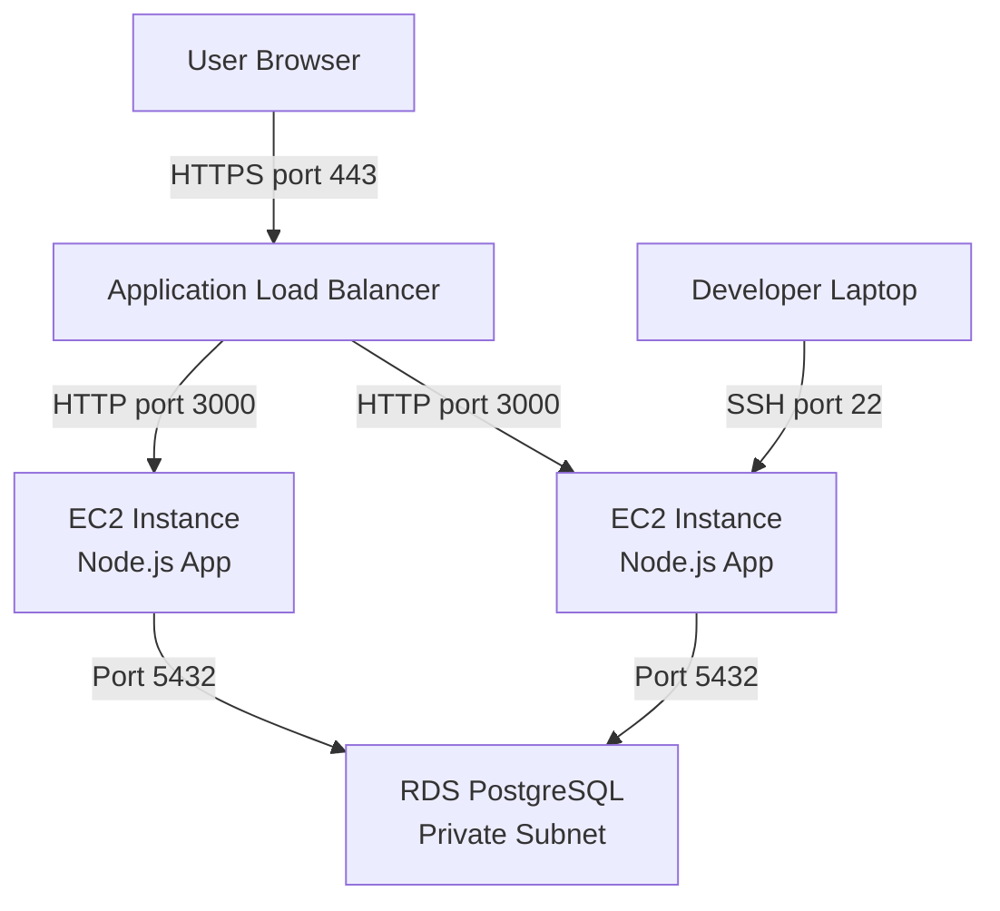

# AWS EC2 — Revision Notes

> AWS Certified Developer Associate (DVA-C02)
> Beginner-friendly revision document. Concepts explained and related to hands-on EC2 experience, including Node.js / Next.js deployment scenarios.

---

## Table of Contents

1. [What is Amazon EC2?](#1-what-is-amazon-ec2)
2. [EC2 Sizing & Configuration Options](#2-ec2-sizing--configuration-options)
3. [EC2 Instance Types](#3-ec2-instance-types)
4. [EC2 User Data (Bootstrapping)](#4-ec2-user-data-bootstrapping)
5. [Public IPv4 vs Private IPv4](#5-public-ipv4-vs-private-ipv4)
6. [Stop, Start, Reboot, and Terminate](#6-stop-start-reboot-and-terminate)
7. [Elastic IP](#7-elastic-ip)
8. [Security Groups](#8-security-groups)
9. [Connecting to EC2 via SSH from Windows](#9-connecting-to-ec2-via-ssh-from-windows)
10. [Fixing SSH Private Key Permissions on Windows](#10-fixing-ssh-private-key-permissions-on-windows)
11. [EC2 Instance Connect (Browser-Based SSH)](#11-ec2-instance-connect-browser-based-ssh)
12. [Basic Linux Commands After Connecting](#12-basic-linux-commands-after-connecting)
13. [EC2 Purchasing Options](#13-ec2-purchasing-options)
14. [EC2 in a Web Application Architecture](#14-ec2-in-a-web-application-architecture)
15. [Common Mistakes and Troubleshooting](#15-common-mistakes-and-troubleshooting)
16. [Practical Learning Checklist](#16-practical-learning-checklist)
17. [Important Interview Questions](#17-important-interview-questions)

---

## 1. What is Amazon EC2?

**EC2 = Elastic Compute Cloud.**

EC2 is Amazon's Infrastructure as a Service (IaaS) offering. It lets you rent virtual servers on demand — pay only for what you use, with no need to purchase, rack, or maintain physical hardware.

> EC2 is one of the most popular and fundamental AWS services. Understanding it is key to understanding how the cloud works.

### Why do we need EC2?

Before cloud computing, launching a new server meant:

- Ordering physical hardware (days or weeks of lead time).
- Setting up a data centre, power, networking, cooling.
- Paying for it whether it was used at capacity or not.
- Manually scaling up during traffic spikes — often impossible in time.

EC2 replaces all of that with an API call or a few clicks in the console.

| Traditional Server | EC2 |
|---|---|
| Physical machine in a data centre | Virtual machine on AWS hardware |
| Weeks to provision | Seconds to minutes to launch |
| Idle costs even when not used | Pay only while the instance runs |
| Hard to scale | Scale up or down on demand |
| You manage hardware | AWS manages the physical infrastructure |

### What is a virtual server?

A virtual server (virtual machine / VM) is software that simulates a physical computer. Multiple VMs can share the same physical server, each isolated from the others. AWS uses hypervisor technology to carve one physical host into many EC2 instances, each with its own CPU, RAM, network, and storage.

```text
Physical AWS Server
│
├── EC2 Instance (your Node.js app)
├── EC2 Instance (another customer)
└── EC2 Instance (another customer)
```

You only see your own instance. AWS handles the physical layer.

### What EC2 mainly consists of

From the instructor's notes:

- **Renting virtual machines (EC2)** — the compute instances themselves.
- **Storing data on virtual drives (EBS)** — Elastic Block Store volumes.
- **Distributing load across machines (ELB)** — Elastic Load Balancer.
- **Scaling the services using an auto-scaling group (ASG)** — adds/removes instances automatically.

### Real-world example: hosting a Node.js application

```text
You build a Next.js app
        ↓
Launch an EC2 instance (e.g. t3.micro running Ubuntu)
        ↓
SSH in, install Node.js, deploy your app
        ↓
Open port 3000 in the Security Group
        ↓
Users reach your app at the EC2 public IP or via a domain
```

If traffic spikes (e.g. a product launch), you can:

1. Manually stop the instance and change to a larger instance type (vertical scaling), or
2. Add more instances and put a load balancer in front (horizontal scaling).

---

## 2. EC2 Sizing & Configuration Options

When launching an EC2 instance, you configure several dimensions:

| Option | What it means |
|---|---|
| **Operating System** | Linux, Windows, or macOS |
| **CPU** | Number of virtual CPUs (vCPUs) and their generation |
| **RAM** | Memory available to the instance |
| **Storage** | Network-attached (EBS / EFS) or local hardware (Instance Store) |
| **Network card** | Network speed and public IP address |
| **Firewall rules** | Security Group (virtual firewall) |
| **Bootstrap script** | EC2 User Data — commands to run on first launch |

You pick an **instance type** (like `t2.micro` or `m5.4xlarge`) which bundles a specific combination of CPU, RAM, and network performance. The AMI (Amazon Machine Image) determines the operating system and pre-installed software.

---

## 3. EC2 Instance Types

### Naming convention

```text
m5.2xlarge
│ │  └── size within the class (larger = more resources)
│ └───── generation (higher = newer, more efficient hardware)
└──────── instance class
```

### Instance families

| Family | Purpose | Typical use cases |
|---|---|---|
| **General Purpose** (t, m) | Balanced CPU / memory / network | Web servers, code repos, small databases |
| **Compute Optimized** (c) | High-performance CPU | Batch processing, media transcoding, HPC, ML, gaming servers |
| **Memory Optimized** (r, x, z) | Large data sets in RAM | In-memory databases, real-time big data, BI caches |
| **Storage Optimized** (i, d, h) | High sequential read/write to local storage | OLTP, NoSQL databases, data warehousing, distributed file systems |
| **Accelerated Computing** (p, g, f, inf) | Hardware accelerators / GPUs | ML training, video rendering, FPGA |
| **HPC Optimized** (hpc) | High-performance computing clusters | Tightly coupled scientific workloads |

### Example instance comparison (from instructor notes)

| Instance | vCPU | Mem (GiB) | Storage | Network |
|---|---|---|---|---|
| t2.micro | 1 | 1 | EBS Only | Low to Moderate |
| t2.xlarge | 4 | 16 | EBS Only | Moderate |
| c5d.4xlarge | 16 | 32 | 1 × 400 NVMe SSD | Up to 10 Gbps |
| r5.16xlarge | 64 | 512 | EBS Only | 20 Gbps |
| m5.8xlarge | 32 | 128 | EBS Only | 10 Gbps |

> **t2.micro** is the instance used throughout this course. It falls in the **Free Tier** (up to 750 hours/month) and is a General Purpose instance — a good starting point.

> Useful comparison tool: [https://instances.vantage.sh](https://instances.vantage.sh)

---

## 4. EC2 User Data (Bootstrapping)

### What is EC2 User Data?

User Data is an optional script you provide when launching an EC2 instance. AWS runs it automatically during the instance's very first boot. This is called **bootstrapping** — automating the initial configuration of a machine so it is ready to serve traffic immediately, without manual intervention.

> **Bootstrapping** = launching commands when a machine starts.

### Why use it?

Without User Data you would have to SSH into every new instance and manually install software. User Data automates tasks like:

- Running OS updates (`apt update`)
- Installing software (nginx, Node.js, Docker, etc.)
- Downloading application code or configuration files
- Starting services
- Setting environment variables

### Key behavior

- User Data **runs only once** — during the first boot of the instance.
- If you stop and start the instance, User Data **does not run again** (the instance reboots into the existing state).
- If you need it to run again, you must explicitly configure the script to run on every boot (using tools like `cloud-init`), which is an advanced use case.
- User Data scripts execute with **root privileges** — no `sudo` prefix is needed.

```text
Launch EC2 Instance
       ↓
First Boot
       ↓
AWS injects User Data into the instance
       ↓
Script runs with root privileges
       ↓
Instance is fully configured and ready
```

### Practical example: install and start Nginx

```bash
#!/bin/bash

apt update -y

apt install nginx -y

systemctl start nginx

systemctl enable nginx
```

**Line-by-line explanation:**

| Line | What it does |
|---|---|
| `#!/bin/bash` | Shebang — tells the OS to run this script with bash |
| `apt update -y` | Refreshes the package index so the latest versions are found; `-y` auto-confirms |
| `apt install nginx -y` | Installs the Nginx web server without prompting |
| `systemctl start nginx` | Starts the Nginx service immediately |
| `systemctl enable nginx` | Configures Nginx to start automatically whenever the instance reboots |

After this script finishes, an HTTP request to the instance's public IP on port 80 returns the Nginx welcome page — without any manual SSH work.

### How to provide User Data in the console

1. Launch Instance → scroll to **Advanced details**.
2. Paste your script in the **User data** text box.
3. Leave the default encoding (plain text, not base64) unless you know you need base64.
4. Launch the instance.

### Common mistake

Forgetting to open port 80 in the Security Group. The script can install Nginx perfectly, but inbound HTTP traffic will time out until you add an inbound rule allowing port 80.

---

## 5. Public IPv4 vs Private IPv4

### What is a Public IPv4 address?

A public IP is routable on the open internet. Any device anywhere can initiate a connection to a public IP address. When AWS assigns an EC2 instance a public IP, it becomes reachable from your laptop, your users' browsers, or external APIs.

### What is a Private IPv4 address?

A private IP exists only inside your AWS Virtual Private Cloud (VPC). External internet users cannot reach it directly. EC2 instances use private IPs to communicate with each other inside the same network (e.g. your app server talking to your database server).

Reserved private IP ranges (not routable on the public internet):

```text
10.0.0.0    –  10.255.255.255
172.16.0.0  –  172.31.255.255
192.168.0.0 –  192.168.255.255
```

### Why AWS assigns both

| Use | IP type |
|---|---|
| You SSH in from your laptop | Public IP |
| Your app serves users on the internet | Public IP |
| App server talks to database server (same VPC) | Private IP |
| AWS internal routing | Private IP |

```text
Your Laptop (internet)
        │
        ▼ Public IP (e.g. 54.210.11.3)
EC2 Instance
        │
        ▼ Private IP (e.g. 10.0.1.5)
RDS Database (same VPC)
```

### Key differences

| Feature | Public IPv4 | Private IPv4 |
|---|---|---|
| Reachable from the internet | Yes | No |
| Changes after stop/start | Yes (unless Elastic IP) | No, stays the same |
| Assigned by | AWS automatically | AWS automatically (from VPC CIDR) |
| Used for | Internet-facing communication | Internal VPC communication |

---

## 6. Stop, Start, Reboot, and Terminate

These are four distinct operations on an EC2 instance. Understanding their differences — especially the IP behavior — is essential for the exam and for real-world management.

### Stop

Shuts down the instance's operating system and stops the underlying virtual hardware. Similar to powering off a physical computer.

- **Billing:** You are **not** billed for compute while the instance is stopped. You are still billed for attached EBS storage.
- **Public IP:** The automatically assigned public IPv4 is **released** back to the AWS pool.
- **Private IP:** Remains unchanged.
- **Data on EBS:** Preserved.
- **Data in RAM:** Lost (RAM is volatile — it disappears when power is cut).

### Start

Powers the instance back on. AWS boots the OS and your applications start.

- **Public IP:** AWS assigns a **new** public IPv4 from the pool. It will usually be different from the one the instance had before it was stopped.
- **Private IP:** Same as before — unchanged.
- **User Data:** Does not run again (it only ran on the very first launch).

> **Practical implication:** If you stop and start an instance, your SSH command will need a new IP address. This is why Elastic IPs exist.

### Reboot

Equivalent to running `sudo reboot` inside the OS, or clicking the reboot button. The OS restarts but the instance never fully powers off at the hypervisor level.

- **Public IP:** **Does not change** during a reboot.
- **Private IP:** Does not change.
- **Billing:** Continuous — you are still billed.
- **RAM:** Cleared during the reboot.

### Terminate

Permanently deletes the instance. The virtual machine, its OS disk, and by default all attached EBS volumes (unless configured otherwise) are deleted.

- **Public IP:** Released permanently.
- **Private IP:** Released.
- **Data:** Lost unless you:
  - Created an AMI (snapshot of the full instance) before terminating.
  - Configured EBS volumes with "Delete on Termination = No".
- **Billing:** Stops immediately.
- **Reversibility:** None. You cannot undo a termination.

### Summary table

| Operation | Public IP | Private IP | Data (EBS) | Billing | Reversible? |
|---|---|---|---|---|---|
| **Stop** | Released | Unchanged | Preserved | Only EBS | Yes (Start it again) |
| **Start** | New IP assigned | Unchanged | Preserved | Full billing resumes | — |
| **Reboot** | Unchanged | Unchanged | Preserved | Continuous | — |
| **Terminate** | Released | Released | Deleted (default) | Stops | ❌ No |

### Practical example

```text
Scenario: You SSH into your EC2 instance using its public IP (54.210.11.3).
You stop the instance to save money overnight.

Next morning you start it again.
AWS assigns a new public IP: 3.95.47.21

Your old SSH command no longer works:
ssh -i .\EC2-Tutorial.pem ec2-user@54.210.11.3  ← connection refused

You must use the new IP:
ssh -i .\EC2-Tutorial.pem ec2-user@3.95.47.21  ← works
```

---

## 7. Elastic IP

### What is an Elastic IP?

An Elastic IP (EIP) is a **static public IPv4 address** that you allocate to your AWS account. Unlike a regular public IPv4 that is released when an instance stops, an Elastic IP belongs to you until you explicitly release it. You can associate it with any EC2 instance and move it to a different instance at any time.

### Why do we need it?

The core problem: every time you stop and start an EC2 instance, its public IP changes. If you have:

- A DNS record pointing to your server's IP,
- Firewall rules on a client side whitelisting your server's IP,
- Configuration files that hardcode the IP,

...they all break every time the instance restarts.

An Elastic IP solves this by giving you a fixed, consistent address.

### Comparison

| Feature | Regular Public IPv4 | Elastic IP |
|---|---|---|
| Changes after stop/start | **Yes** | **No** |
| Static / persistent | No | Yes |
| You allocate it manually | No (AWS assigns automatically) | Yes |
| Movable between instances | No | Yes |
| Cost | Free while instance is running | May incur charges (see below) |

### Lifecycle

```text
1. Allocate an Elastic IP (from the EC2 console → Elastic IPs)
        ↓
2. Associate it with an EC2 instance
        ↓
3. Instance now has a fixed public IP
        ↓
4. If instance stops/starts → public IP stays the same
        ↓
5. Disassociate from instance (IP is now "unattached")
        ↓
6. Associate with a different instance (or reassociate with the same one)
        ↓
7. Release the Elastic IP when no longer needed
```

### How to allocate and associate (console)

1. EC2 Console → **Elastic IPs** → **Allocate Elastic IP address**.
2. Click **Allocate**.
3. Select the new EIP → **Actions → Associate Elastic IP address**.
4. Choose the instance and (optionally) the private IP to associate with.
5. Click **Associate**.

### How to disassociate and release

1. Select the EIP → **Actions → Disassociate Elastic IP address**.
2. Then: **Actions → Release Elastic IP address**.

### Real-world scenarios where Elastic IP is useful

- **Production servers** that must be reachable at a known IP.
- **Failover:** If your primary instance fails, re-associate the EIP to a standby instance in seconds. Clients never see an IP change.
- **Whitelist scenarios:** A partner's firewall allows traffic from your EIP. If you terminate and replace your instance, you just move the EIP.

### Pricing note

> AWS charges for public IPv4 addresses. As of 2024, AWS started charging for all public IPv4 addresses (including those attached to running instances). An Elastic IP that is **allocated but not associated** with a running instance incurs additional charges. Always release EIPs you are not using.

For current pricing, check: [https://aws.amazon.com/vpc/pricing/](https://aws.amazon.com/vpc/pricing/)

> **AWS Best Practice:** Use Elastic IPs sparingly. For most production use cases, prefer pointing a domain name (via Route 53) to your instance or load balancer DNS name, rather than hard-coding IP addresses.

---

## 8. Security Groups

### What is a Security Group?

A Security Group is a **virtual firewall** that controls inbound and outbound traffic for your EC2 instances (or more precisely, for the network interfaces attached to those instances).

> Security Groups are the fundamental building block of network security in AWS.

Security Groups contain only **rules** — there is no concept of "deny" rules (see below). Rules can reference:

- An IP address or CIDR range (e.g. `203.0.113.5/32`, `0.0.0.0/0`)
- Another Security Group (useful for allowing traffic between instances in the same VPC)

### Inbound rules

Control traffic **coming into** the EC2 instance from outside.

By default: **all inbound traffic is blocked**.

You explicitly add rules to allow specific traffic:

```text
Type       Protocol   Port Range   Source
SSH        TCP        22           My IP (203.0.113.5/32)
HTTP       TCP        80           Anywhere (0.0.0.0/0)
HTTPS      TCP        443          Anywhere (0.0.0.0/0)
Custom     TCP        3000         Anywhere (0.0.0.0/0)   ← Node.js dev server
```

### Outbound rules

Control traffic **leaving** the EC2 instance to the outside.

By default: **all outbound traffic is allowed**.

This means your instance can download packages, call external APIs, and communicate freely unless you explicitly restrict it.

### Stateful behavior — the most important Security Group concept

Security Groups are **stateful**. This means:

> If you allow a connection in one direction, the **return traffic** for that established connection is automatically allowed — even if no explicit rule covers it.

**Example:**

You allow inbound SSH (port 22). Your laptop sends a TCP connection request. AWS allows it in.

Your EC2 instance sends a response back to your laptop. Even though there is no outbound rule specifically for "port X back to my laptop", that return traffic is **automatically permitted** because it belongs to an already-established, allowed connection.

This is different from a **stateless** firewall (like AWS Network ACLs), where you must explicitly allow both the inbound request AND the outbound response.

```text
Stateful (Security Group)
─────────────────────────
Inbound rule: Allow port 22 from My IP
   → Response traffic back to My IP is automatically allowed

Stateless (Network ACL)
─────────────────────────
Must add both:
  Inbound rule:  Allow port 22 from My IP
  Outbound rule: Allow ephemeral ports back to My IP
```

### Security Group diagram

```
                    ┌─────────────────────┐
                    │    Security Group    │
                    │                      │
 Your PC ──────────▶│ Port 22 (Inbound)   │──────▶  EC2 Instance
 (Authorised IP)    │ ALLOW               │
                    │                      │
 Other PC ─── ✗ ──▶│ Port 22 (Inbound)   │  ✗ blocked
 (Not authorised)   │ NOT in rules         │
                    │                      │
                    │ Outbound             │──────▶  Internet
                    │ All traffic ALLOW    │        (packages, APIs)
                    └─────────────────────┘
```

### Referencing Security Groups

Instead of specifying an IP range, you can reference another Security Group as the source. This is powerful inside a VPC:

```text
Load Balancer Security Group (SG-LB)
        ↓
EC2 Instance Security Group
  Inbound rule: Allow port 80 from SG-LB
```

Only traffic from instances or load balancers attached to `SG-LB` is allowed. No IP address management needed — the rule automatically applies to whatever instances you attach `SG-LB` to.

### Good to know

- One Security Group can be **attached to multiple instances**.
- One EC2 instance can have **multiple Security Groups** (their rules combine — the most permissive rule wins).
- Security Groups are **locked to a Region/VPC combination**. A Security Group from `us-east-1` cannot be used in `eu-west-1`.
- Security Groups live **outside** the EC2 instance. If traffic is blocked, the instance never sees the packets — it cannot distinguish blocked traffic from no traffic at all.
- **If your app times out**, it is almost always a Security Group issue (port not open).
- **If your app responds with "connection refused"**, the port is reachable (Security Group is fine), but the app is not listening or not running.

### Classic ports to know

| Port | Protocol | Purpose |
|---|---|---|
| 21 | FTP | File Transfer Protocol — upload files to a file share |
| 22 | SSH | Secure Shell — remote Linux server access |
| 22 | SFTP | Secure File Transfer Protocol — upload files using SSH |
| 80 | HTTP | Web traffic (unencrypted) |
| 443 | HTTPS | Web traffic (encrypted) |
| 3000 | Custom | Node.js / Next.js development server |
| 3389 | RDP | Remote Desktop Protocol — remote Windows server access |
| 5432 | PostgreSQL | PostgreSQL database connections |

### SSH access security note

Always restrict SSH (port 22) to **My IP** rather than `0.0.0.0/0` (everyone). Leaving port 22 open to the world exposes your instance to automated brute-force and credential-stuffing attacks within seconds of launch.

```text
Bad:   Source = 0.0.0.0/0  (anyone on the internet can try to log in)
Good:  Source = My IP only  (only your current IP can reach port 22)
```

> It is good practice to maintain a **dedicated Security Group for SSH** separate from your application Security Group, so you can quickly remove SSH access when not needed.

---

## 9. Connecting to EC2 via SSH from Windows

### What is SSH?

**SSH (Secure Shell)** is a network protocol that lets you log into and control a remote Linux server from your local terminal. All traffic is encrypted. SSH is how you:

- Deploy code to your EC2 instance.
- Install software.
- View logs.
- Configure the server.
- Run commands as if you were sitting in front of the machine.

### What is a PEM private key?

When you launch an EC2 instance, AWS asks you to create or select a **key pair**. This generates:

- A **private key** (`.pem` file) — downloaded to your machine. Never shared.
- A **public key** — stored by AWS on the EC2 instance in `~/.ssh/authorized_keys`.

SSH uses asymmetric cryptography:

```text
Your .pem file (private key)
        +
AWS public key on the instance
        =
Mutual authentication without a password
```

AWS does not store your private key. If you lose it, you cannot SSH into the instance through normal means.

### Environment

- OS: Windows 11
- Terminal: Windows PowerShell 5.1
- Private key: `EC2-Tutorial.pem`
- Key location: `C:\CODING\EC2-Tutorial.pem`

### SSH connection command

```powershell
ssh -i .\EC2-Tutorial.pem ec2-user@YOUR_EC2_PUBLIC_IP
```

Replace `YOUR_EC2_PUBLIC_IP` with the public IPv4 address shown in the EC2 console.

**Breakdown:**

| Part | Meaning |
|---|---|
| `ssh` | The SSH client |
| `-i .\EC2-Tutorial.pem` | Use this file as the private key (`-i` = identity) |
| `ec2-user` | The default username for Amazon Linux AMIs |
| `@YOUR_EC2_PUBLIC_IP` | The public IP address of the instance |

### Choosing the correct SSH username

The username depends on the AMI (Amazon Machine Image) used to launch the instance:

| AMI | Default SSH username |
|---|---|
| Amazon Linux 2 / Amazon Linux 2023 | `ec2-user` |
| Ubuntu | `ubuntu` |
| Debian | `admin` or `debian` |
| CentOS | `centos` |
| RHEL (Red Hat) | `ec2-user` |
| SUSE Linux | `ec2-user` or `root` |

> `root` is generally **not** the default SSH username. Direct `root` login is disabled by default on most AMIs for security reasons. You SSH in as `ec2-user` (or `ubuntu`, etc.) and then use `sudo` for privileged operations.

### SSH connection diagram

```
Your Windows Laptop
(PowerShell + EC2-Tutorial.pem)
           │
           │  SSH over port 22 (internet)
           ▼
    EC2 Instance (Linux)
    Public IP: YOUR_EC2_PUBLIC_IP
    Security Group: port 22 open to My IP
```

---

## 10. Fixing SSH Private Key Permissions on Windows

### The problem

When you first try to SSH using a freshly downloaded `.pem` file on Windows, you may see:

```text
Bad permissions.
Try removing permissions for user: BUILTIN\Users

WARNING: UNPROTECTED PRIVATE KEY FILE!

Permissions for '.\EC2-Tutorial.pem' are too open.

This private key will be ignored.

Permission denied (publickey,gssapi-keyex,gssapi-with-gssapi).
```

### Why SSH rejects the key

SSH enforces that private key files are **only readable by the owner**. If your `.pem` file has permissions that allow other users on the system to read it, the SSH client refuses to use it as a security measure.

On Linux/macOS you fix this with `chmod 400 file.pem`. Windows has a different permission model using **ACLs (Access Control Lists)**.

When Windows downloads a file, it inherits permissions from the parent folder — which often includes `BUILTIN\Users` (all local users) having read access. SSH sees this and refuses.

### The fix — three commands

**Step 1: Remove all inherited permissions**

```powershell
icacls ".\EC2-Tutorial.pem" /inheritance:r
```

`/inheritance:r` = remove (r) all inherited permissions. This strips the inherited `BUILTIN\Users` entries, leaving only explicitly set permissions.

**Step 2: Grant read-only access to the current Windows user**

```powershell
icacls ".\EC2-Tutorial.pem" /grant:r "$($env:USERNAME):(R)"
```

- `$($env:USERNAME)` — dynamically resolves to your Windows username (e.g. `DESKTOP-ABC\YourName`).
- `:(R)` — grants Read-only permission.
- `/grant:r` — replace (`:r`) any existing grant for this user (not add to it).

**Step 3: Verify the permissions are correct**

```powershell
icacls ".\EC2-Tutorial.pem"
```

Expected output (only your username should appear):

```text
.\EC2-Tutorial.pem YourUsername:(R)

Successfully processed 1 files; Failed processing 0 files
```

After these three commands, your SSH connection will succeed.

### Full troubleshooting flow

```text
SSH command fails with "UNPROTECTED PRIVATE KEY FILE"
        ↓
Run: icacls ".\EC2-Tutorial.pem" /inheritance:r
        ↓
Run: icacls ".\EC2-Tutorial.pem" /grant:r "$($env:USERNAME):(R)"
        ↓
Verify: icacls ".\EC2-Tutorial.pem"
        ↓
Retry SSH
        ↓
Connected ✅
```

### Security reminder

> ⚠️ **Never share your `.pem` private key with anyone. Never upload it to GitHub, S3, or any version control system.** Anyone who has this file can SSH into your EC2 instance as long as it is running and port 22 is open.

If your key is compromised:
1. Remove the public key from the instance's `~/.ssh/authorized_keys`.
2. Create a new key pair.
3. Add the new public key to the instance.
4. Delete the old `.pem` file.

---

## 11. EC2 Instance Connect (Browser-Based SSH)

EC2 Instance Connect lets you connect to your Linux instance **directly from the AWS Console in a web browser** — no key file, no terminal setup required.

### How it works

```text
AWS Console → EC2 → Instance → Connect → EC2 Instance Connect
        ↓
AWS temporarily uploads a one-time public key to the instance
        ↓
Browser-based terminal opens
        ↓
You are connected
```

### Notes

- Works out-of-the-box with **Amazon Linux 2** and **Ubuntu** AMIs.
- Port 22 must still be **open** in the Security Group (even though you're not using a local SSH client, AWS's backend still uses SSH under the hood).
- No need to manage or store the `.pem` file for this method.
- Not supported on all AMIs — primarily Amazon Linux 2.

### SSH method comparison

| Method | OS | Key file needed? | Notes |
|---|---|---|---|
| SSH (native) | Mac / Linux | Yes | Built-in `ssh` command |
| SSH (PowerShell) | Windows 10+ | Yes | Native OpenSSH in Windows |
| PuTTY | Windows < 10 | Yes (.ppk format) | Free third-party tool, requires key conversion |
| EC2 Instance Connect | All (browser) | No | Requires port 22 open |

---

## 12. Basic Linux Commands After Connecting

Once you successfully SSH into your EC2 instance, these commands help you understand the environment you're working in.

### `whoami`

```bash
whoami
```

Displays the currently logged-in user. After SSH-ing as `ec2-user`, this confirms which user account you are operating as. Important for understanding whether you need `sudo` for privileged commands.

**Example output:**
```text
ec2-user
```

### `uname -a`

```bash
uname -a
```

Displays detailed kernel and system information: kernel name, hostname, kernel version, build date, architecture, and OS type.

**Example output:**
```text
Linux ip-172-31-X-X 6.1.68-99.145.amzn2023.x86_64 #1 SMP ... x86_64 x86_64 x86_64 GNU/Linux
```

Useful for: confirming the kernel version, understanding the architecture, verifying the OS is what you expected.

### `cat /etc/os-release`

```bash
cat /etc/os-release
```

Shows the Linux distribution name, version, and ID. Different AMIs produce different output here — this tells you exactly which distro and version is running.

**Example output (Amazon Linux 2023):**
```text
NAME="Amazon Linux"
VERSION="2023"
ID="amzn"
...
```

**Example output (Ubuntu):**
```text
NAME="Ubuntu"
VERSION="22.04.3 LTS (Jammy Jellyfish)"
...
```

### `df -h`

```bash
df -h
```

Displays disk usage for all mounted filesystems. The `-h` flag formats sizes in human-readable units (GB, MB).

**Example output:**
```text
Filesystem      Size  Used Avail Use% Mounted on
devtmpfs        4.0M     0  4.0M   0% /dev
/dev/xvda1      8.0G  1.4G  6.6G  18% /
tmpfs           483M     0  483M   0% /dev/shm
```

Useful for: checking if your EBS root volume is running out of space, monitoring disk usage before large operations.

### Why these commands matter

When you first access a new EC2 instance:

```text
whoami         → Confirm your user identity (affects sudo usage)
uname -a       → Confirm OS and kernel version (affects compatible packages)
cat /etc/os-release → Confirm Linux distro (determines package manager: apt vs yum vs dnf)
df -h          → Confirm available disk space before installing software
```

---

## 13. EC2 Purchasing Options

AWS gives you several ways to pay for EC2 capacity, each optimized for different workload patterns.

### On-Demand Instances

Pay by the second (Linux/Windows) or by the hour (other OS) with no upfront commitment.

- Highest unit cost.
- No long-term commitment.
- Best for: **short-term, unpredictable workloads** where you can't forecast usage.
- Best for: testing, development, applications with traffic spikes.

> **Hotel analogy:** Walk in whenever you like, pay the full rack rate, leave whenever you want.

### Reserved Instances

Commit to a specific instance type, Region, OS, and tenancy for 1 or 3 years in exchange for a discount (up to 72% vs On-Demand).

- Payment options: No Upfront, Partial Upfront, All Upfront (more upfront = more discount).
- **Standard Reserved Instances:** Specific attributes are fixed.
- **Convertible Reserved Instances:** You can change instance type, family, OS, scope, and tenancy (up to ~66% discount).
- You can buy and sell standard RIs in the **Reserved Instance Marketplace**.
- Best for: **steady-state, predictable workloads** (e.g. a production database that runs 24/7).

> **Hotel analogy:** Book a room for a year in advance for a big discount.

### Savings Plans

Similar discount level to Reserved Instances (up to 72%), but instead of locking to a specific instance type, you commit to a **dollar amount per hour** (`$10/hour for 1 or 3 years`).

- Locked to an instance **family** and **Region** (e.g. M5 in us-east-1).
- Flexible across instance **size**, **OS**, and **tenancy** within that family and region.
- Usage beyond the commitment is billed at On-Demand rates.
- Best for: flexible long-term usage where you want some instance size flexibility.

> **Hotel analogy:** Commit to spending $X/night for a year, and you can stay in any room category within that hotel.

### Spot Instances

Request spare EC2 capacity at up to **90% discount** vs On-Demand. The catch: AWS can reclaim your instance with a 2-minute warning if the spot price exceeds your maximum bid.

- Cheapest option.
- **Can be interrupted** — unsuitable for critical, persistent workloads.
- Best for: **fault-tolerant, interruption-resilient** workloads: batch jobs, data analysis, image processing, distributed computation, flexible start/end time.

> **Hotel analogy:** The hotel auctions unsold rooms at the last minute for a steep discount — but they can ask you to leave if a full-price guest shows up.

### Dedicated Hosts

A **physical server** dedicated entirely to your use. You get the full hardware with predictable socket/core/VM counts.

- Most expensive option.
- Use when you have **per-socket, per-core, or per-VM** software licenses (BYOL — Bring Your Own License).
- Use when **compliance or regulatory** requirements prohibit sharing hardware.
- Payment: On-Demand (per second) or Reserved (1 or 3 years).

> **Hotel analogy:** You book the entire building.

### Dedicated Instances

Your instances run on hardware dedicated to you, but AWS manages the placement. You may share the physical host with **other instances from your own account**.

- Less control over placement than Dedicated Hosts.
- Cheaper than Dedicated Hosts.
- No BYOL licensing benefit (you don't control the sockets/cores).

| | Dedicated Host | Dedicated Instance |
|---|---|---|
| Physical server dedicated to you | Yes | Yes (but may share with own account) |
| Control over instance placement | Yes | No |
| BYOL licensing (per-socket/core) | Yes | No |
| Cost | Highest | Lower than Dedicated Host |

### Capacity Reservations

Reserve On-Demand capacity in a **specific Availability Zone** for any duration. No time commitment — create or cancel any time.

- **No billing discount** on its own. You pay On-Demand rates whether you use the capacity or not.
- Combine with **Regional Reserved Instances** or **Savings Plans** to get the discount on top.
- Best for: short-term, uninterrupted workloads that must be in a specific AZ.

> **Hotel analogy:** You reserve a room for a specific period and pay for it even if you don't stay — but you're guaranteed the room is there.

### Price comparison example (m4.large, us-east-1)

*(From instructor notes — exact prices change over time; use the AWS Pricing Calculator for current figures.)*

| Price Type | Approx. Price (per hour) |
|---|---|
| On-Demand | $0.10 |
| Spot Instance | $0.038–$0.039 (up to ~61% off) |
| Reserved Instance — 1 year, No Upfront | $0.062 |
| Reserved Instance — 1 year, All Upfront | $0.058 |
| Reserved Instance — 3 years, No Upfront | $0.043 |
| Reserved Instance — 3 years, All Upfront | $0.037 |
| EC2 Savings Plan — 1 year, No Upfront | $0.062 |
| Convertible RI — 1 year, No Upfront | $0.071 |
| Dedicated Host Reservation | Up to ~70% off |
| Capacity Reservations | On-Demand price |

> Current pricing: [https://aws.amazon.com/ec2/pricing/](https://aws.amazon.com/ec2/pricing/)

### Decision guide

```text
Short-term / unpredictable     → On-Demand
Long-term / steady-state       → Reserved Instances or Savings Plans
Cost-sensitive batch jobs      → Spot Instances
Compliance / BYOL licensing    → Dedicated Hosts
Guaranteed AZ capacity         → Capacity Reservations
```

---

## 14. EC2 in a Web Application Architecture

Understanding how EC2 fits into a real-world web app helps contextualize all of the above concepts.

### Simple Node.js / Next.js deployment



- Users reach the app through a **Load Balancer** (not directly to EC2 — better security and scalability).
- EC2 instances run your Node.js / Next.js application.
- They talk to an **RDS database** via its **private IP** (never expose the database publicly).
- The developer SSHs into EC2 for maintenance (port 22, restricted to developer's IP only).

### Security Group architecture for this setup

```text
ALB Security Group
  Inbound:  443 from 0.0.0.0/0 (internet users)
  Outbound: 3000 to EC2 Security Group

EC2 Security Group
  Inbound:  3000 from ALB Security Group
  Inbound:  22   from Developer IP only
  Outbound: 5432 to RDS Security Group
  Outbound: 443  to 0.0.0.0/0 (Node.js needs to call external APIs, npm, etc.)

RDS Security Group
  Inbound:  5432 from EC2 Security Group
  Outbound: (default allow all)
```

---

## 15. Common Mistakes and Troubleshooting

### SSH: "UNPROTECTED PRIVATE KEY FILE"

**Cause:** `.pem` file has permissions too open (other Windows users can read it).  
**Fix:** See [Section 10](#10-fixing-ssh-private-key-permissions-on-windows).

### SSH: "Connection timed out"

**Cause:** Port 22 is not open in the Security Group, or you have the wrong IP address.  
**Fix:** Check the Security Group inbound rules. Confirm the instance's current public IP (it changes after stop/start).

### SSH: "Permission denied (publickey)"

**Causes:**
1. Wrong username (e.g. using `ec2-user` with an Ubuntu instance instead of `ubuntu`).
2. Wrong key file (`-i` pointing to the wrong `.pem`).
3. Key file permissions not fixed yet.
4. The key pair doesn't match the one used to launch the instance.

**Fix:** Verify username for your AMI (see [Section 9](#9-connecting-to-ec2-via-ssh-from-windows)), confirm key file path and permissions.

### App accessible but returns "connection refused"

**Cause:** The Security Group is open (not a firewall issue), but the application is not running or not listening on the expected port.  
**Fix:** SSH in and check: `systemctl status nginx` or `ps aux | grep node`. Start the service if it's down.

### App unreachable, times out

**Cause:** Almost always a Security Group issue — the port is not open.  
**Fix:** Check inbound rules on the instance's Security Group. Add the required port.

### User Data script didn't work

**Common causes:**
1. Script has a syntax error — the script ran but exited early.
2. Port not opened in Security Group (app installed, but not reachable).
3. Service not started — script ran but the last `systemctl start` command failed.

**Debug:** SSH in and check: `cat /var/log/cloud-init-output.log` to see the User Data script's output.

### Instance won't start after stopping

If you've changed the instance type (requires a stop + start), or if the instance store data was expected to persist (it doesn't — instance store is ephemeral), you may encounter issues. EBS-backed instances start cleanly.

### Wrong public IP after stop/start

**Expected behavior.** The public IP changes after every stop/start cycle. Use an **Elastic IP** if you need a fixed address.

---

## 16. Practical Learning Checklist

- [ ] Understand what EC2 is and why it exists (IaaS, virtual machines).
- [ ] Understand EC2 sizing and configuration options (OS, CPU, RAM, storage, network, Security Groups, User Data).
- [ ] Identify and explain the EC2 instance type families (General Purpose, Compute Optimized, Memory Optimized, etc.).
- [ ] Launch an EC2 instance from the AWS Console.
- [ ] Configure EC2 User Data to automate software installation at launch.
- [ ] Understand bootstrapping and when User Data runs.
- [ ] Understand public vs private IPv4 — purpose and differences.
- [ ] Stop, start, reboot, and terminate an EC2 instance and observe IP behavior.
- [ ] Understand Elastic IP — allocate, associate, disassociate, and release.
- [ ] Configure Security Groups — inbound and outbound rules, ports, protocols.
- [ ] Understand stateful vs stateless firewall behavior.
- [ ] Connect to EC2 via SSH from Windows PowerShell using a `.pem` key.
- [ ] Fix Windows `.pem` file permissions using `icacls`.
- [ ] Connect via EC2 Instance Connect (browser-based).
- [ ] Execute basic Linux commands after connecting (`whoami`, `uname -a`, `cat /etc/os-release`, `df -h`).
- [ ] Understand all EC2 purchasing options (On-Demand, Reserved, Savings Plans, Spot, Dedicated Host, Dedicated Instance, Capacity Reservations).
- [ ] Choose the right purchasing option for a given workload description.
- [ ] Understand how EC2 fits into a web application architecture (with Load Balancer, RDS, Security Groups).
- [ ] Troubleshoot common SSH and Security Group issues.

---

## 17. Important Interview Questions

### EC2 Fundamentals

**Q: What is EC2 and what does the name stand for?**  
A: EC2 stands for Elastic Compute Cloud. It is AWS's IaaS offering that lets you rent virtual servers (instances) on demand without managing physical hardware.

**Q: What does "Elastic" mean in EC2?**  
A: You can scale capacity up or down quickly — add more instances when demand increases, remove them when it drops. You pay only for what you use.

**Q: What components make up an EC2 instance?**  
A: An AMI (OS + software), instance type (CPU + RAM), storage (EBS or Instance Store), networking (VPC, subnet, Security Group), and optionally a key pair and User Data.

**Q: What is the difference between an AMI and an instance type?**  
A: An AMI defines the operating system, pre-installed software, and configuration. The instance type defines the hardware resources (vCPUs, RAM, network performance). An instance is an AMI launched on an instance type.

---

### User Data

**Q: What is EC2 User Data and when does it run?**  
A: User Data is a script provided at launch time. It runs **once** during the first boot to automate initial configuration (installing packages, starting services, etc.).

**Q: Does User Data run again after you stop and start an instance?**  
A: No. By default, User Data runs only on the first boot. Stopping and starting the instance does not re-run it.

**Q: What privileges does a User Data script run with?**  
A: Root privileges. No `sudo` is needed inside a User Data script.

**Q: What is "bootstrapping" in the context of EC2?**  
A: Bootstrapping is the process of automatically configuring an instance when it first starts, using User Data scripts — installing software, configuring services — so the instance is immediately ready without manual intervention.

---

### Public vs Private IPv4

**Q: What is the difference between a public IPv4 and a private IPv4 on EC2?**  
A: A public IP is routable on the internet (used for external access). A private IP exists only within the VPC (used for internal communication between resources).

**Q: What happens to the public IP when you stop an EC2 instance?**  
A: It is released back to AWS's pool. When you start the instance again, a new (different) public IP is assigned.

**Q: Does stopping and starting an instance change the private IP?**  
A: No. The private IP remains the same across stop/start cycles.

---

### Stop vs Reboot vs Terminate

**Q: What is the difference between stopping and terminating an EC2 instance?**  
A: Stopping shuts the instance down (EBS data preserved, can restart). Terminating permanently deletes the instance and its EBS root volume (unless configured to keep it).

**Q: Does rebooting change the public IP address?**  
A: No. A reboot keeps the same public IP. The IP only changes on a stop + start.

**Q: You stop an EC2 instance and restart it the next day. What has changed?**  
A: The public IPv4 address will likely be different. Everything else (private IP, EBS data, instance configuration) is unchanged.

---

### Elastic IP

**Q: What is an Elastic IP?**  
A: A static public IPv4 address that you allocate to your account. It persists across stop/start cycles and can be moved between instances.

**Q: When should you use an Elastic IP?**  
A: When you need a fixed public IP — for example, when a client's firewall whitelists your IP, when DNS records point to your server's IP, or for quick failover by moving the IP to a standby instance.

**Q: Does an Elastic IP cost money?**  
A: Yes. AWS charges for public IPv4 addresses, including EIPs associated with running instances. EIPs that are allocated but not associated with a running instance incur additional charges. Release EIPs you are not using.

---

### Security Groups

**Q: What is a Security Group?**  
A: A virtual firewall attached to EC2 instances (or network interfaces) that controls inbound and outbound traffic using rules.

**Q: Are Security Groups stateful or stateless?**  
A: Stateful. If an inbound connection is allowed, the return traffic for that connection is automatically permitted without a matching outbound rule.

**Q: What is the default inbound and outbound behavior of a Security Group?**  
A: Inbound: all traffic is **blocked** by default. Outbound: all traffic is **allowed** by default.

**Q: Can you have Deny rules in a Security Group?**  
A: No. Security Groups support only Allow rules. To block specific traffic, use **Network ACLs** (stateless, subnet-level) which do support Deny rules.

**Q: Can you attach a Security Group to multiple instances?**  
A: Yes. One Security Group can be attached to many instances.

**Q: Can an EC2 instance have multiple Security Groups?**  
A: Yes. Rules from all attached Security Groups combine — the most permissive rule applies.

**Q: Your EC2 app is timing out. What's the likely cause?**  
A: A Security Group issue — the required port is not open in the inbound rules.

**Q: Your EC2 app responds with "connection refused". What does this mean?**  
A: The Security Group is fine (port is reachable), but the application is not running or not listening on that port.

**Q: Why should SSH be restricted to My IP instead of 0.0.0.0/0?**  
A: Leaving port 22 open to everyone exposes the instance to brute-force attacks from automated bots. Restricting to your IP means only you can attempt to connect.

---

### SSH and PEM Files

**Q: What is a PEM file?**  
A: A file containing a private key used for SSH authentication. AWS provides it when you create a key pair. It is used to authenticate to EC2 instances instead of a password.

**Q: What username do you use to SSH into an Amazon Linux EC2 instance?**  
A: `ec2-user`.

**Q: Why does SSH reject a `.pem` file on Windows with "UNPROTECTED PRIVATE KEY FILE"?**  
A: SSH requires that the private key file be readable only by the owner. On Windows, downloaded files often inherit broad permissions (including `BUILTIN\Users` read access). SSH treats this as a security risk and refuses the key.

**Q: How do you fix overly permissive `.pem` permissions on Windows?**  
A: Remove inherited permissions with `icacls "file.pem" /inheritance:r`, then grant read-only access to the current user with `icacls "file.pem" /grant:r "$($env:USERNAME):(R)"`.

---

### EC2 Purchasing Options

**Q: What is the most cost-effective EC2 purchasing option?**  
A: Spot Instances — up to 90% cheaper than On-Demand. The trade-off is that they can be interrupted.

**Q: Which option gives the biggest discount for long-term, steady-state workloads?**  
A: Reserved Instances (3-year All Upfront) or EC2 Savings Plans provide the best sustained discounts (up to 72%).

**Q: When would you use Dedicated Hosts vs Dedicated Instances?**  
A: Dedicated Hosts when you need per-socket/per-core software licensing (BYOL) or strong regulatory requirements. Dedicated Instances when you just need hardware isolation without licensing control.

**Q: What happens to a Spot Instance when the spot price exceeds your maximum bid?**  
A: AWS gives you a 2-minute warning and then terminates (interrupts) the instance.

**Q: A company has a stable workload running for 24/7 for 3 years. Which pricing model should they use?**  
A: Reserved Instances (3-year term) for maximum savings.

**Q: What is a Capacity Reservation?**  
A: It reserves On-Demand capacity in a specific Availability Zone. You pay On-Demand rates whether you use it or not. Used when you need a guaranteed capacity guarantee in a specific AZ without a time commitment.

---

### General Troubleshooting

**Q: What is the first thing you should check if you can't reach your EC2 application?**  
A: Security Group inbound rules — confirm the required port is open to the correct source IP.

**Q: How can you view User Data script execution logs?**  
A: SSH into the instance and read `/var/log/cloud-init-output.log`.

**Q: What is EC2 Instance Connect and when is it useful?**  
A: A browser-based SSH tool in the AWS Console. Useful when you don't have your `.pem` file handy, or when troubleshooting permission issues. Requires port 22 to be open.

**Q: Does EC2 Instance Connect require a key file?**  
A: No. AWS temporarily injects a one-time key. However, port 22 must still be open in the Security Group.

---

> *This document covers EC2 Basics as taught in the AWS Certified Developer Associate (DVA-C02) course (Stephane Maarek / Datacumulus), supplemented with hands-on Windows SSH troubleshooting details from real learning sessions.*
